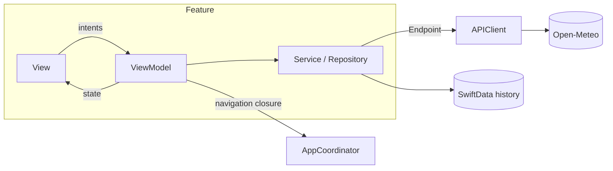

# BartoszWeather


A weather forecast app for iOS 17 and later, built with SwiftUI.
You search for a city, pick it from the results and get its forecast: current conditions, the next 24 hours and the next 7 days.
The data comes from [Open-Meteo](https://open-meteo.com), which needs no API key.

This is my solution to a recruitment task. The app is small, but I built it the way I would build a production app
that a team will maintain and extend.

## Features

How each requirement of the task is met:

| Requirement | Implementation |
|---|---|
| **City name validation**: no digits, no special characters except hyphen and space, Polish letters supported | [`CityQuery`](BartoszWeather/Features/Search/Models/CityQuery.swift) accepts only letters (any script, so `ą ć ę ł ń ó ś ź ż` work), spaces and hyphens. It trims the text and collapses repeated whitespace, needs at least 2 characters and searches at most 60. Invalid input gets a red field, an inline message and a hint such as *Try “Nowy Sącz” or “Bielsko-Biała”*. |
| **Results shown in a list** | The search runs as you type, after a 350 ms debounce, and stale answers are dropped. Names come from the Open-Meteo geocoding API in the device language. Each result shows its region and country, with the typed part highlighted. |
| **Search history kept between launches** | Each successfully loaded forecast adds the city to a history stored with SwiftData ([`SwiftDataHistoryRepository`](BartoszWeather/Persistence/History/SwiftDataHistoryRepository.swift)). The history keeps the 10 most recent cities, each with its last forecast, and supports swipe to delete and *Clear*. |
| **Navigation to forecast details** | A tap pushes the forecast screen onto a coordinator-driven `NavigationStack`. |
| **Current temperature, cloud cover, chance of precipitation, hourly temperatures** | A header with the temperature, condition and feels-like temperature. Tiles for cloud cover, chance of rain, wind (with direction and gusts) and humidity. A horizontal list of the next 24 hours. |
| **Optional: more data on the details screen** | A 7-day forecast with daily highs and lows drawn as range bars on a shared scale. |
| **Loading state** | Skeleton placeholders on both screens. |
| **No internet connection** | A dedicated offline state with a retry button. When a forecast can't be loaded, the app shows the city's stored forecast (up to 24 hours old) with a status line such as *No connection · Showing data from 14:05*. |
| **Empty search result** | *No city found for “…”* with a hint to check the spelling. |
| **API errors** | Rate limiting (HTTP 429) has its own message on both screens, and a server outage (5xx) has its own on the forecast screen. Every other failure (timeout, decoding, transport) shows a generic error. All of them offer a retry button. A failed pull-to-refresh keeps the forecast on screen and reports the problem above it. |
| **Dark Mode** | Every color is a light/dark asset in the design tokens. |
| **iOS 17+, any device** | The deployment target is iOS 17.0. The app runs on iPhone and iPad, in portrait and landscape. |

Extras:

- The sky gradient follows the weather (clear, overcast, snow, storm) and the time of day at the city.
  Changes between screens and states cross-fade.
- Dynamic Type up to the accessibility sizes, with layouts that reflow (the metric grid drops to one column).
  VoiceOver labels and actions, for example deleting a history entry.
- Times are shown in the city's own time zone, including across daylight-saving changes.

## Getting started

Requirements: Xcode 27 or later (the project uses the Xcode 27 project format) and an iOS 17+ simulator or device. There is no API key to set and there are no third-party dependencies.

```sh
git clone https://github.com/Jurny02/BartoszWeather.git
cd BartoszWeather
open BartoszWeather.xcodeproj
```

Choose the `BartoszWeather` scheme and run. To run on a physical device, set your own development team under *Signing & Capabilities*.

From the command line:

```sh
xcodebuild build -scheme BartoszWeather -destination 'platform=iOS Simulator,name=iPhone 17'
xcodebuild test  -scheme BartoszWeather -destination 'platform=iOS Simulator,name=iPhone 17'
swiftlint lint --strict
```

## Architecture

The app uses **MVVM-C**: views render state and forward user intents, `@Observable` view models own the state and logic,
and a coordinator owns navigation. View models report navigation through closures and never touch SwiftUI navigation types.

The code is split into folders inside one app target. Each folder is laid out as a future module,
so turning them into Swift packages later is a mechanical change. API meant to cross module boundaries is already `public`.

| Folder | Contents | May depend on |
|---|---|---|
| `App/` | Entry point, composition root, `AppCoordinator` | everything |
| `Core/` | Domain models (`City`, `Forecast`, `WeatherCondition`…), formatting, shared repository protocols | nothing |
| `Networking/` | HTTP client, `Endpoint` protocol, Open-Meteo endpoints and DTOs | `Core` |
| `Persistence/` | SwiftData schema, stored DTOs, `SwiftDataHistoryRepository` | `Core` |
| `Theming/` | Design tokens (colors, typography, spacing, radii, sizes), icons, shared components | `Core` |
| `Features/Search/` | Search screen, view model, query validation, city search service | `Core`, `Networking`, `Theming` |
| `Features/Forecast/` | Forecast screen, view model, forecast service and repository | `Core`, `Networking`, `Theming` |

Features never import each other.



Key decisions:

- **Composition root.** [`BartoszWeatherApp`](BartoszWeather/App/BartoszWeatherApp.swift) creates every dependency once
  and injects it through initializers. Everything else depends on protocols.
- **DTOs stay in `Networking`.** Feature services such as
  [`OpenMeteoForecastService`](BartoszWeather/Features/Forecast/Services/OpenMeteoForecastService.swift) map them to domain models.
  The mapping is defensive: out-of-range values are treated as missing, and missing values show as *No data* instead of failing the screen.
- **The HTTP layer isn't tied to today's use case.** An [`Endpoint`](BartoszWeather/Networking/HTTP/Endpoint.swift) describes
  its method, headers, body, decoding and accepted content types. Adding a POST endpoint or another response format
  needs no change to [`URLSessionAPIClient`](BartoszWeather/Networking/Client/URLSessionAPIClient.swift).
- **Persistence stays behind protocols.** `SearchHistoryRepository` and `ForecastStore` live in `Core`.
  SwiftData and its stored types stay inside `Persistence`, and only the composition root names the concrete repository.
  If the store on disk can't be opened, the app falls back to an in-memory store and keeps working.
- **Presentation logic outside views.** Texts, icons and state mapping live in small `Presentation` types
  (for example [`SearchCityContent`](BartoszWeather/Features/Search/Presentation/SearchCityContent.swift) and
  [`ForecastIssue`](BartoszWeather/Features/Forecast/Presentation/ForecastIssue.swift)) that can be unit tested.
  Views stay thin and take models.

## Error handling

- The client reports every failure as an [`APIError`](BartoszWeather/Networking/HTTP/APIError.swift)
  (`offline`, `timeout`, `server(status:)`, `decoding`, `invalidRequest`, `transport`).
  Each screen turns these into its own states.
- Cancellation is never shown as an error. It is passed on as `CancellationError`, and a cancelled or outdated request
  never overwrites newer state.
- A successful response that isn't JSON, such as a captive-portal login page, is treated as offline.
- Responses over 1 MB are rejected. The session is ephemeral and fails fast when there is no connection.

## Testing

- **Swift Testing only** (`@Test`, `#expect`, `#require`). A SwiftLint rule forbids importing XCTest.
- About 300 tests in [`BartoszWeatherTests/`](BartoszWeatherTests), which mirrors the source folders.
  They cover validation, view models, DTO mapping, endpoints, the HTTP client, persistence, formatting and design tokens.
- No network in unit tests. The HTTP client is tested with a `URLProtocol` stub, and everything above it uses
  hand-written fakes that keep the whole protocol contract, including errors and cancellation.
  SwiftData runs in memory, and an immediate clock replaces the search debounce.
- Built test-first: write a failing test, make it pass, refactor.

## Quality and process

- **CI** ([GitHub Actions](.github/workflows/ci.yml)) runs SwiftLint in strict mode, where every warning fails the build,
  and builds and tests on Xcode 27 for every pull request and every push to `main`.
- **Swift 6 language mode** with main-actor default isolation and no concurrency warnings.
- **SOLID** and a doc comment on every type are project rules, written down in [`CLAUDE.md`](CLAUDE.md).
- **Git history.** One branch and one pull request per step, merged with merge commits and never squashed,
  so you can follow the whole development process. Commits follow [Conventional Commits](https://www.conventionalcommits.org),
  and each one builds with passing tests.

## AI-assisted development

The task allowed AI agents, and I used [Claude Code](https://claude.com/claude-code) as a pair programmer. To keep the output consistent and reviewable:

- The architecture, testing and git rules are in [`CLAUDE.md`](CLAUDE.md), so every session follows the same conventions.
- Every change is written test-first and has to pass lint and the full test suite.
- Before each push, an independent review agent that didn't write the code reviews the branch
  ([`pre-push-review`](.claude/skills/pre-push-review/SKILL.md)), and its findings are fixed before the pull request.
- I made the design, naming and scope decisions and reviewed every pull request myself.

## Possible next steps

- Move the folders into real Swift packages. The structure and `public` API are ready for it.
- Localization. User-facing strings are already localizable (`String(localized:)` and `LocalizedStringKey`);
  adding a String Catalog and translations is what remains.
- Weather for the current location, widgets, and units chosen by the user.
- Snapshot or UI tests for the key screens.

## Credits

Weather and geocoding data by [Open-Meteo.com](https://open-meteo.com), licensed under [CC BY 4.0](https://creativecommons.org/licenses/by/4.0/).
